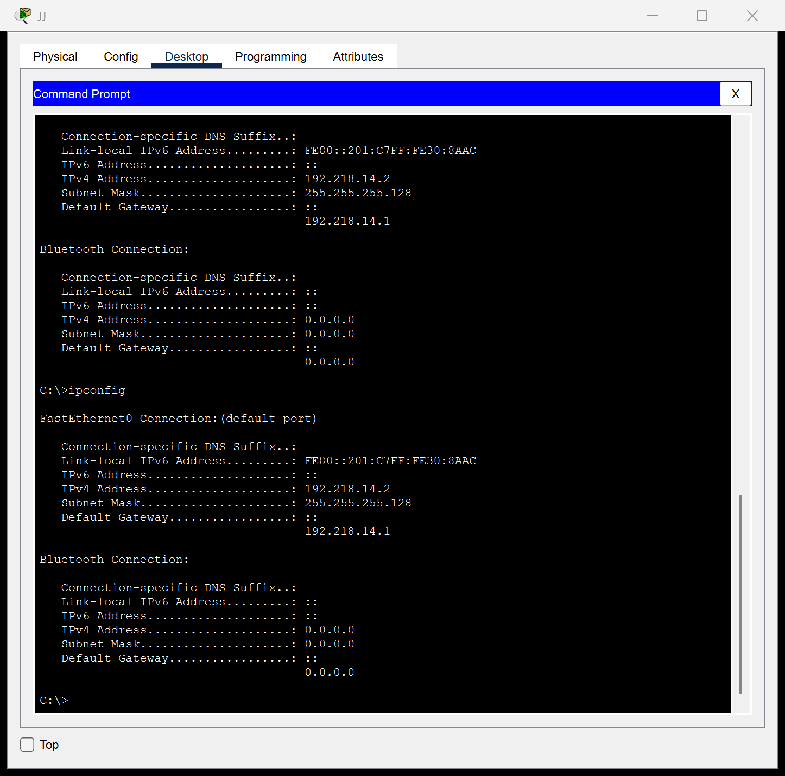
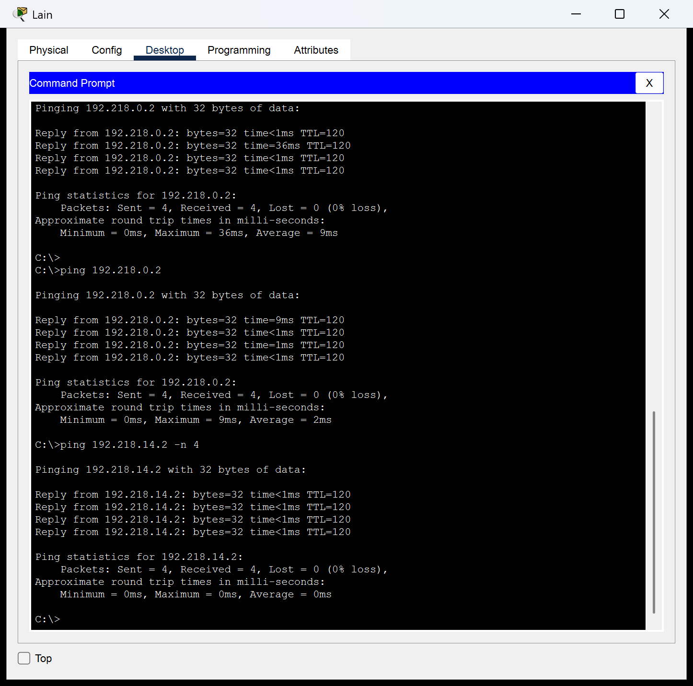
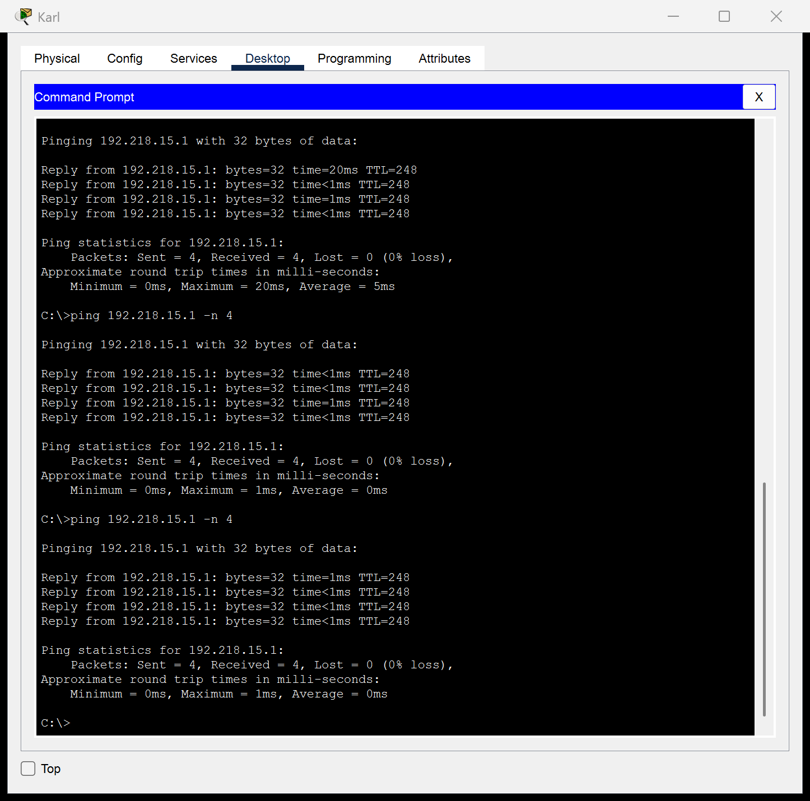
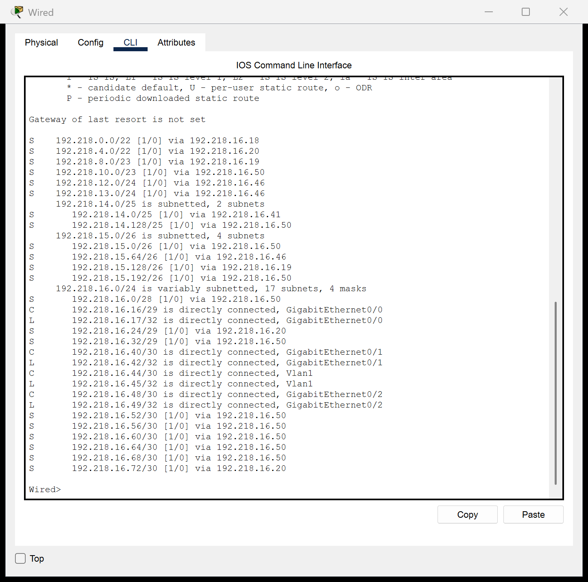

# Jarkom-Modul-4-2026-K-14

## Anggota Kelompok

| Nama                         | NRP       |
| ---------------------------- | --------- |
| Muhammad Satrio Utomo        | 5027251022 |
| Sebastian Elroi Hasian Panjaitan | 5027251040 |

## Laporan

[LINK SPREADSHEET] Subnetting Modul 4 - K14.xlsx (tersebut pada repositori ini)

### CPT - VLSM

1. Berikut topologi yang dibuat untuk *cisco packet tracer*.

   

   Setelah dilakukan analisa terhadap topologi tersebut, dapat disimpulkan terdapat sebanyak **25 subnet** yang perlu dilakukan. Prefix yang menjadi acuan seluruh pengerjaan adalah **192.218.0.0/19** dan *routing* yang digunakan adalah *static routing* dengan prinsip jalur terpendek (*shortest-path*), sehingga *router* yang hanya memiliki satu tetangga *upstream* cukup dikonfigurasi *default route*.

2. Total penggunaan subnet.

   Total subnet yang digunakan adalah **25 subnet** dimana total IP yang digunakan adalah **2814 IP** dan menghasilkan total ip yang available adalah **4118 IP** dimana artinya pendekatan terbesar adalah mendapatkan subnet **/20**. Untuk ini dapat lihat pada Spreadsheet yang sudah diberikan diatas.

   Dan berikut adalah hasil VLSM Tree yang ada:

   

3. Static routing.

   Pada praktikum ini hanya diharuskan untuk melakukan *static routing*, dimana dengan hal tersebut harus dilakukan config terhadap tiap router untuk bagaimana bisa mendapatkan rute atau jalur yang diharapkan.

   Topologi dibagi menjadi tiga wilayah sehingga pembagian rute setiap router dirangkum dalam tiga berkas berikut (total **202 entri** *static route*):

   - [center route](routings/cpt/center-route.txt) (Cyberia & Wired, sebagai *backbone* topologi)

   - [left route](routings/cpt/left-route.txt) (Psyche, Copland, Schumann, Accela)

   - [right route](routings/cpt/right-route.txt) (Navi, Tachibana, Deus, Protocol7, Knights, Phantoma, Shibuya)

4. Setting static ip

   Untuk melakukan *static ip* bisa diset pada tiap tiap router ataupun client, dengan melihat ip range yang sudah ditentukan atau sudah didapatkan pada Spreadsheet. Berikut adalah bukti konfigurasi IP *statis* pada *host* JJ (Subnet A1, 192.218.14.0/25) yang telah berhasil dilakukan:

   

5. Testing koneksi (ping)

   Validasi dilakukan dengan melakukan *ping* antar *node* dari wilayah topologi yang berjauhan untuk memastikan seluruh *static route* berjalan dengan baik.

   Berikut adalah bukti ping dari host **Lain** (Subnet A10, sisi kanan topologi) menuju host **JJ** (Subnet A1, sisi tengah topologi):

   

   Berikut adalah bukti ping dari host **Karl** (Subnet A3, sisi kiri topologi) menuju gateway LAN Shibuya 192.218.15.1 (Subnet A10, sisi kanan topologi):

   

   Seluruh ping antar node berhasil terhubung. Tambahan verifikasi tabel routing di salah satu router utama (Wired) menunjukkan seluruh 25 subnet sudah terdaftar dengan next-hop yang tepat:

   

### GNS3 - CIDR

Bagian ini mencakup pengerjaan topologi **GNS3** dengan metode *CIDR* (route summarization). Berkas dan laporan untuk bagian tersebut menyusul pada folder `routings/gns3/`.

## Catatan Teknis CPT

Beberapa catatan implementasi yang dilakukan pada *cisco packet tracer*:

1. Angka dalam tanda kurung pada nama *host* (contoh: `Karl (700 host)`, `Reika (53 host)`) menunjukkan **pembagian jumlah host dari soal ke masing-masing *end-point* dalam LAN-nya**, sehingga total label tiap LAN persis sama dengan kolom *Jumlah IP* pada Spreadsheet (contoh: A7 = `Alice (200 host)` + `Reika (53 host)` = 253). *Switch* diberi nama polos, sedangkan subnet *router-to-router* (A2, A15–A25) tidak memiliki *host* sehingga tidak diberi label.

2. *Router* menggunakan model campuran: **2911** untuk Cyberia & Wired, dan **2811** untuk router lainnya, sesuai dengan gambar topologi yang diberikan. *Interface tambahan* pada 2811 didapat melalui modul `NM-1FE-TX` / `NM-2FE2W`.

3. *Link* Cyberia → Wired → Navi direalisasikan sebagai *port channel* `Vlan1` pada Wired (karena *port SFP* pada `HWIC-1GE-SFP` tidak dapat menerima kabel tembaga pada PT), sehingga IP `192.218.16.45/30` ditanam pada *interface* `Vlan1` dengan *uplink* fisik `FastEthernet0/0/0`.

4. Kabel antar *router-to-router* menggunakan *crossover*, sedangkan *router-to-switch* dan *switch-to-host* menggunakan *straight-through*.
